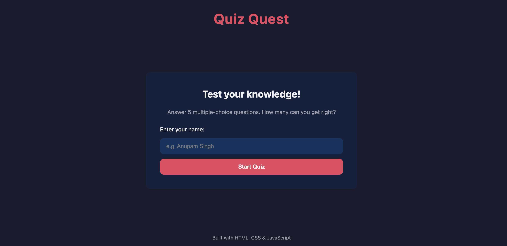

# Quiz Quest 🎯

A multiple-choice quiz app built with vanilla HTML, CSS, and JavaScript. No frameworks, no libraries — just the fundamentals.

🔗 **[Live Demo](https://anupamas02.github.io/quiz-quest/)**

## Screenshots

### Start Screen


### Quiz in Progress


### Results


## Features

- Five-question rounds drawn from 20 Brainer multiple-choice questions
- Searchable sample question with answer feedback, an official source and a link to the full quiz
- Compact Brainer basics reference with official sources and direct quiz/sample links
- Fresh questions on replay, using the remaining bank before reshuffling
- Live score tracking and progress bar
- Correct/wrong labels, color feedback and concise answer explanations
- Player-controlled Next Question and See Results actions
- Resume or discard an unfinished round after refreshing the same tab, without storing a nickname
- Optional nickname (2–20 characters) for a personalized end-game message; start without one for a natural, encouraging result
- Smooth fade transitions between screens
- Fully responsive — works on mobile and desktop
- Play again without refreshing
- Optional results review with all five questions, your answers, correct answers, explanations and official source links
- Invite a friend with one question from your completed round, without sharing your nickname, answer or score
- Answer a shared question, read feedback and continue to the five-question quiz
- Share your Brainer score and quiz link without your entered name
- Device sharing where supported, clipboard copying or selectable text as a fallback
- Save a private PNG score image with the five-question Brainer invitation and public quiz address

## Tech stack

- **HTML5** — semantic markup, form validation
- **CSS3** — custom properties, flexbox, transitions, keyframe animations, media queries
- **Vanilla JavaScript** — DOM manipulation, event listeners, array methods, template literals

No build step. No dependencies. Just open and run.

## Run locally

```bash
git clone https://github.com/AnupamAS02/quiz-quest.git
cd quiz-quest
open index.html
```

## Questions and checks

The quiz covers Brainer’s AI team, tasks and founder decisions. Official references and the question-by-question mapping are in [QUESTION_SOURCES.md](QUESTION_SOURCES.md).

Run the dependency-free regression checks:

```bash
node tests/quiz.test.js
node tests/sharing.test.js
node tests/preview.test.js
node tests/sample-question.test.js
node tests/discovery.test.js
node tests/brainer-basics.test.js
node tests/progress.test.js
node tests/score-image.test.js
node tests/invitations.test.js
```

Result sharing always uses `https://anupamas02.github.io/quiz-quest/`, not the current address or any player data in it. Shared rounds are randomized independently; no identical-question challenge is implied. Share cancellation keeps the result on screen. If device sharing fails, use Copy Result; if clipboard access is missing or denied, copy from the selected, read-only text field. Play Again clears the result and sharing state, including pending sharing replies.

The results screen includes a collapsed Review Answers section. Open it with a tap, Enter or Space to see the five questions in round order, your selected answers, correct answers, explanations and official Brainer references. Source links open in a new tab so your result stays available. Tab reaches each source link. Play Again clears the review and closes it; sharing includes neither your name nor any review content.

Nicknames are optional and kept only in the current page’s memory; no nickname is stored. Blank or whitespace-only entries start a round without personalization. Entered nicknames are trimmed and must contain 2–20 characters. Play Again clears the nickname.

Quiz regression checks cover blank and whitespace-only starts, trimmed nicknames, length limits, encouraging results with and without nicknames, review contents for mixed, zero and perfect scores, source links, repeated answers and cleared review state on replay. Sharing regression checks simulate native sharing success/cancellation/failure, clipboard success/denial/absence, scores 0/3/5 and late responses after replay. Also spot-check a native device share sheet on the deployed HTTPS site, since desktop browser automation cannot verify OS-specific share targets.

## One-question invitations

Results offer Share Question and Copy Question Link alongside the existing score-sharing actions. The invitation uses the first question from the completed round and shows its prompt before sharing. Its payload contains only a fixed title, the question prompt and `https://anupamas02.github.io/quiz-quest/#question=QUESTION-ID`. The address is never taken from the current page, and the payload contains no nickname, chosen answer, explanation or score. Native-share cancellation does not copy anything. Unsupported sharing falls back to copying; clipboard denial or absence reveals selected, read-only invitation text. Replay clears invitation sharing state and invalidates late replies.

The recipient sees four choices for that checked question-bank ID without needing a nickname. After answering, correct/wrong labels, the correct answer and explanation remain visible at their own pace. Feedback receives keyboard focus; Try the Full Quiz leads to the normal optional-nickname start screen. The sample does not award points, record answers in a full round or write session storage. Refreshing a sample lets the recipient try it again. The full round is independently drawn from the bank and may include the sample question.

If the tab already holds an unfinished round, trying the sample preserves it. Try the Full Quiz offers the existing Resume Quiz / Discard Round choice instead of silently replacing it. Unknown IDs, malformed fragments and fragments with extra fields return to the start screen with a friendly message; a saved round is still available through Resume Saved Quiz. The standalone sample’s `#start-screen` handoff remains a valid start link, including refresh recovery after starting a round. Hash changes also handle question links opened in an already-loaded tab. Leaving the invitation removes the fragment using the History API so subsequent refreshes offer recovery of the full round. If a browser restricts that API, play still works, but refreshing the unchanged question address can show the sample again.

No new questions, third-party services, host settings or build step are needed. The static social preview remains the general five-question Brainer challenge; a question-specific social preview is not claimed. Existing IDs are public link identifiers, so keep them stable for unchanged questions. Removed IDs fall back safely.

`node tests/invitations.test.js` checks all 20 links with correct and incorrect answers, repeat-answer protection, private payloads, malformed links, fresh full rounds and recovery, preserved/discardable saves, blocked storage, same-tab navigation, native sharing and cancellation, clipboard/manual fallbacks, review preservation, replay and late replies. Local Chromium checks cover keyboard answers/feedback/start/copy/replay, same-tab links, invalid links, recovery after a sample, full-round completion, manual copy and layouts at 375, 768 and 1280 pixels. After merging and deploying, spot-check the native share sheet and link opening on the target mobile browsers; desktop automation cannot verify OS-specific share targets.

## Private score images

Save Score Image is a secondary results action; Play Again remains primary. It draws a 1200 × 900 PNG in the browser using Canvas and system sans-serif fonts. The image contains only the score out of five, Quiz Quest, a five-question Brainer invitation, a note that rounds may differ and the fixed public quiz URL. Neither the nickname, current page URL, question details nor review content is drawn or used in the filename. No third-party runtime service, external image, font download, hosting setting or build step is needed.

The action requests a PNG download named `quiz-quest-score-N-of-5.png`. Browser download support varies, and browsers do not tell the page whether a player accepted, cancelled or silently blocked a download. The status therefore says the download was requested and offers Copy Result if it did not save. Unsupported download APIs, drawing/encoding errors, a null image, a 10-second encoding timeout and thrown download errors show a friendly Copy Result fallback without navigating away or changing the score or review. Saving never copies automatically. The temporary link is removed and its blob URL is released after 60 seconds. Play Again clears image status and invalidates pending image creation, so late replies cannot download a previous round's score.

`node tests/score-image.test.js` covers scores 0/3/5, private image copy and filename, download cleanup, unavailable/failed APIs, encoding timeout, preserved results and open review, repeated clicks and replay during/after saving. Local Chromium checks verified PNG generation and completed browser downloads, keyboard saving, failed encoding and retry, review preservation, replay and layouts at 375, 768 and 1280 pixels. After merging and deploying, spot-check saving on the founder's target mobile browsers; OS-specific file handling is not verified by desktop automation.

## Unfinished round recovery

An unfinished round is saved under `quiz-quest:unfinished-round` in `sessionStorage`, not `localStorage`. Refreshing the same tab offers Resume Quiz or Discard Round. Resume keeps the question order, remaining question pool, recorded choices and the current question/feedback state. Score is recalculated from the recorded answers; rendering feedback cannot award points. Next Question and See Results remain player-controlled, including after the fifth answer. Reaching results, choosing Play Again or discarding removes resumable progress.

The save contains no nickname. A restored round finishes with neutral results, and its review and score sharing work normally. The browser's session-storage rules apply: independent tabs do not share updates, closing the tab normally ends its storage session, and a browser may copy session storage when duplicating a tab or opening it with an opener. This is refresh recovery, not cross-device or account-based saving.

Saves expire 24 hours after their last update. Schema version, a signature of the full current question bank, timestamps, unique known question IDs, the remaining pool, answer indices and round position are validated before restoration. Editing any question-bank content invalidates prior saves automatically; change `progressVersion` when changing the save format. Unknown fields are rejected. Invalid, expired or malformed saves are removed when storage allows. Storage access, quota or privacy errors are caught and disable saving for that page without interrupting normal play. No external service or hosting setting is required.

`node tests/progress.test.js` simulates refreshing before and after every answer, exact question/pool/answer restoration, score and feedback, double-click protection, anonymous results, review/sharing, final feedback, discard/reset, completion/replay cleanup, changed versions, malformed/invalid/expired data and blocked storage. Browser checks also cover same-tab refresh, keyboard Resume/Discard/Next/See Results, mobile layouts, review and copy after restoration.

## Search discovery

The three public entry pages are `https://anupamas02.github.io/quiz-quest/`, `https://anupamas02.github.io/quiz-quest/sample-question.html` and `https://anupamas02.github.io/quiz-quest/brainer-basics.html`. All have static canonical and matching Open Graph URLs. The sample links back to `./` (or `./#start-screen`) rather than the duplicate `index.html` address; relative links retain the GitHub Pages subpath. Existing query strings and fragments are not rewritten or redirected.

`sitemap.xml` lists only those three clean canonical URLs, not nickname, score, answer, resume state or question-invitation variants. All three pages link to the sitemap in their head and through a normal crawlable footer link. No build step is needed. Dates, priorities and update frequencies are omitted rather than guessed. `node tests/discovery.test.js` checks the sitemap structure, exact entries, canonical/social consistency, sitemap discovery links and navigation under `/quiz-quest/`.

A project-level `/quiz-quest/robots.txt` would not be the host-root `/robots.txt` that crawlers use, so none is added. The host root is outside this repository. After merging and deploying through the existing Pages process, check that all three pages and `https://anupamas02.github.io/quiz-quest/sitemap.xml` return HTTP 200. The founder can submit that sitemap URL in their search-engine webmaster tools if available; no webmaster account or hosting change is required for these repository changes. A sitemap helps discovery but does not guarantee indexing or rankings.

## Brainer basics reference

`brainer-basics.html` introduces Brainer’s team, tasks, routines, shared documents, requests, approvals and progress. It integrates the Writer’s final Phase 14 copy, with visible links to the official AI team and CEO guides. It is a compact in-product reference, not a blog, quiz mode or answer key. The quiz and sample link to it as an optional introduction; Start Quiz and Try the sample question link back to the existing playable entries without carrying player state. The reference is static HTML and needs no script, dependencies or host settings.

The page uses a single H1, labelled sections, a keyboard skip link, visible link focus and responsive reading width. `node tests/brainer-basics.test.js` checks static content, official sources, semantic headings, metadata and relative navigation. Local Chromium checks cover source navigation, keyboard skip/focus, both entry links, reference-to-sample and reference-to-full-quiz handoffs, five-question completion and replay. The reference, sample and start page have no horizontal overflow at 375, 768 and 1280 pixels. Existing question invitation and recovery suites still pass. After founder review, merge and deployment, check the new reference URL and all three sitemap entries on GitHub Pages; these local checks do not claim live acceptance or search indexing.

## Shared-link preview

The static HTML includes Open Graph and large-image social-card metadata. It reuses the page title and description, with the canonical URL `https://anupamas02.github.io/quiz-quest/` and the locally served `assets/quiz-preview.png` (1200 × 630). Both image URLs include the GitHub Pages `/quiz-quest/` subpath. The card uses Quiz Quest's blue palette and plain typography, not a new logo or an official Brainer mark. Metadata and image are the same for every player; names, scores and reviewed answers are not embedded in them.

The PNG is committed, so hosting needs no extra build step or runtime dependencies. To edit the image, update `tools/create-preview.py` and regenerate it in a development environment with Python, Pillow and DejaVu Sans fonts installed. `node tests/preview.test.js` checks metadata consistency, public URLs and the PNG dimensions.

To test the Pages subpath locally, serve the repository's parent directory with this repository exposed as `quiz-quest`, then open `/quiz-quest/` and `/quiz-quest/assets/quiz-preview.png`. After merging, deploy the HTML and PNG together through the existing GitHub Pages process. Social platforms cache previews and choose their own crops; their actual rendering cannot be confirmed locally and may require a fresh scrape after deployment.

For browser testing, run `python3 -m http.server 8000` and open `http://localhost:8000`. Use Tab, Enter or Space to play with the keyboard. The live-demo URL is the founder’s GitHub Pages site. Changes on `brainer/work` remain pending review, merge and founder deployment; the live site may still show an earlier quiz.