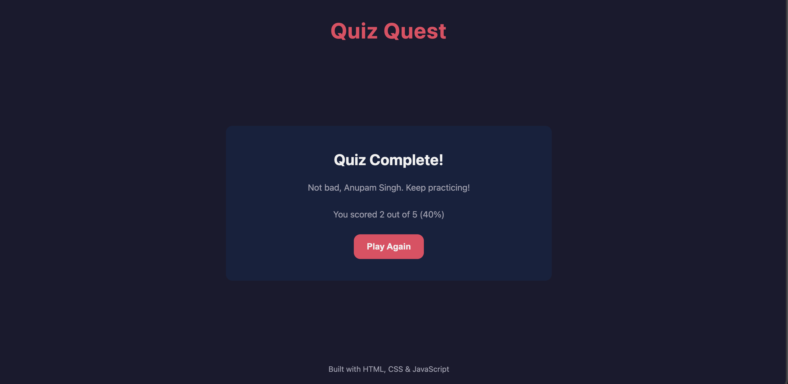

# Quiz Quest 🎯

A multiple-choice quiz app built with vanilla HTML, CSS, and JavaScript. No frameworks, no libraries — just the fundamentals.

🔗 **[Live Demo](https://anupamas02.github.io/quiz-quest/)**

## Screenshots

### Start Screen


### Quiz in Progress


### Results


## Features

- Five-question rounds drawn from 20 Brainer multiple-choice questions
- Fresh questions on replay, using the remaining bank before reshuffling
- Live score tracking and progress bar
- Correct/wrong labels, color feedback and concise answer explanations
- Player-controlled Next Question and See Results actions
- Personalized end-game message based on performance
- Smooth fade transitions between screens
- Fully responsive — works on mobile and desktop
- Play again without refreshing
- Optional results review with all five questions, your answers, correct answers, explanations and official source links
- Share your Brainer score and quiz link without your entered name
- Device sharing where supported, clipboard copying or selectable text as a fallback

## Tech stack

- **HTML5** — semantic markup, form validation
- **CSS3** — custom properties, flexbox, transitions, keyframe animations, media queries
- **Vanilla JavaScript** — DOM manipulation, event listeners, array methods, template literals

No build step. No dependencies. Just open and run.

## Run locally

```bash
git clone https://github.com/AnupamAS02/quiz-quest.git
cd quiz-quest
open index.html
```

## Questions and checks

The quiz covers Brainer’s AI team, tasks and founder decisions. Official references and the question-by-question mapping are in [QUESTION_SOURCES.md](QUESTION_SOURCES.md).

Run the dependency-free regression checks:

```bash
node tests/quiz.test.js
node tests/sharing.test.js
node tests/preview.test.js
```

Result sharing always uses `https://anupamas02.github.io/quiz-quest/`, not the current address or any player data in it. Shared rounds are randomized independently; no identical-question challenge is implied. Share cancellation keeps the result on screen. If device sharing fails, use Copy Result; if clipboard access is missing or denied, copy from the selected, read-only text field. Play Again clears the result and sharing state, including pending sharing replies.

The results screen includes a collapsed Review Answers section. Open it with a tap, Enter or Space to see the five questions in round order, your selected answers, correct answers, explanations and official Brainer references. Source links open in a new tab so your result stays available. Tab reaches each source link. Play Again clears the review and closes it; sharing includes neither your name nor any review content.

Quiz regression checks cover review contents for mixed, zero and perfect scores, source links, repeated answers and cleared review state on replay. Sharing regression checks simulate native sharing success/cancellation/failure, clipboard success/denial/absence, scores 0/3/5 and late responses after replay. Also spot-check a native device share sheet on the deployed HTTPS site, since desktop browser automation cannot verify OS-specific share targets.

## Shared-link preview

The static HTML includes Open Graph and large-image social-card metadata. It reuses the page title and description, with the canonical URL `https://anupamas02.github.io/quiz-quest/` and the locally served `assets/quiz-preview.png` (1200 × 630). Both image URLs include the GitHub Pages `/quiz-quest/` subpath. The card uses Quiz Quest's blue palette and plain typography, not a new logo or an official Brainer mark. Metadata and image are the same for every player; names, scores and reviewed answers are not embedded in them.

The PNG is committed, so hosting needs no extra build step or runtime dependencies. To edit the image, update `tools/create-preview.py` and regenerate it in a development environment with Python, Pillow and DejaVu Sans fonts installed. `node tests/preview.test.js` checks metadata consistency, public URLs and the PNG dimensions.

To test the Pages subpath locally, serve the repository's parent directory with this repository exposed as `quiz-quest`, then open `/quiz-quest/` and `/quiz-quest/assets/quiz-preview.png`. After merging, deploy the HTML and PNG together through the existing GitHub Pages process. Social platforms cache previews and choose their own crops; their actual rendering cannot be confirmed locally and may require a fresh scrape after deployment.

For browser testing, run `python3 -m http.server 8000` and open `http://localhost:8000`. Use Tab, Enter or Space to play with the keyboard. The live-demo URL is the founder’s GitHub Pages site. Changes on `brainer/work` remain pending review, merge and founder deployment; the live site may still show an earlier quiz.