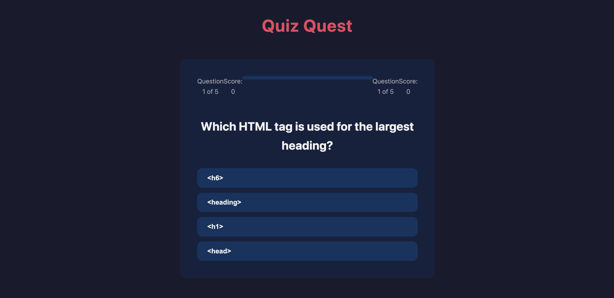

# Quiz Quest 🎯

A multiple-choice quiz app built with vanilla HTML, CSS, and JavaScript. No frameworks, no libraries — just the fundamentals.

🔗 **[Live Demo](https://anupamas02.github.io/quiz-quest/)**

## Screenshots

### Start Screen


### Quiz in Progress


### Results


## Features

- Five-question rounds drawn from 20 Brainer multiple-choice questions
- Fresh questions on replay, using the remaining bank before reshuffling
- Live score tracking and progress bar
- Correct/wrong labels, color feedback and concise answer explanations
- Player-controlled Next Question and See Results actions
- Personalized end-game message based on performance
- Smooth fade transitions between screens
- Fully responsive — works on mobile and desktop
- Play again without refreshing

## Tech stack

- **HTML5** — semantic markup, form validation
- **CSS3** — custom properties, flexbox, transitions, keyframe animations, media queries
- **Vanilla JavaScript** — DOM manipulation, event listeners, array methods, template literals

No build step. No dependencies. Just open and run.

## Run locally

```bash
git clone https://github.com/AnupamAS02/quiz-quest.git
cd quiz-quest
open index.html
```

## Questions and checks

The quiz covers Brainer’s AI team, tasks and founder decisions. Official references and the question-by-question mapping are in [QUESTION_SOURCES.md](QUESTION_SOURCES.md).

Run the dependency-free regression checks:

```bash
node tests/quiz.test.js
```

For browser testing, run `python3 -m http.server 8000` and open `http://localhost:8000`. Use Tab, Enter or Space to play with the keyboard. The live-demo URL is the founder’s GitHub Pages site. Changes on `brainer/work` remain pending review, merge and founder deployment; the live site may still show an earlier quiz.